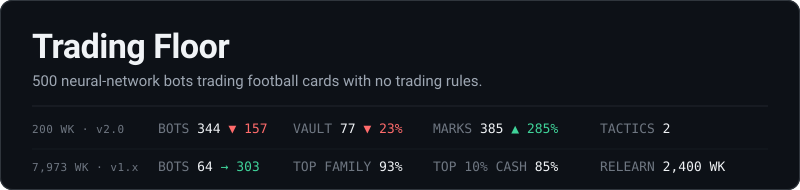
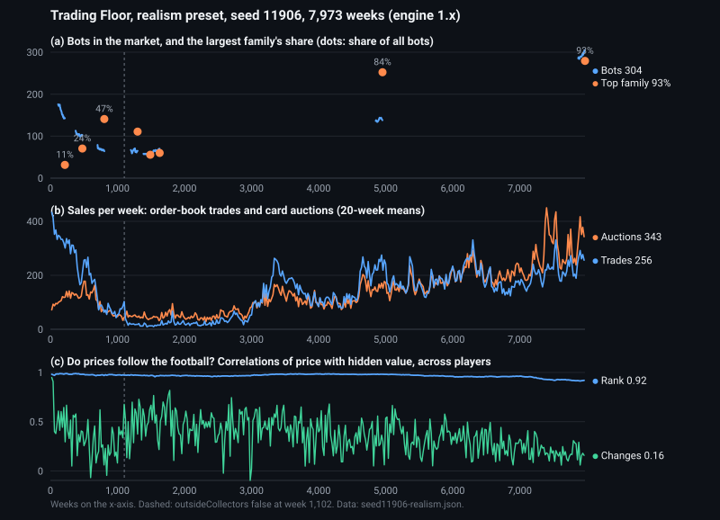

[](https://github.com/sakisaki-dev/trading-floor/actions/workflows/test.yml)
[](CHANGELOG.md)
[](https://sakisaki-dev.github.io/trading-floor/)
[](.nvmrc)

**Five hundred tiny neural networks walk onto a trading floor.** They buy and sell cards of football players whose
careers are still being played out, week by week, in a simulated league. Nobody tells them how to trade. They never
see what a card is really worth. The world sets the forces (fees, taxes, rent, bad luck) and evolution keeps whatever
works.

So far they have formed rival camps, bred a single family that took over the floor, gamed their own scoreboard,
spent 2,400 weeks relearning how to trade with each other, and never once worked out how to lend. This repository is
the world, the bots, every experiment and every mistake.

**[Watch it run in your browser.](https://sakisaki-dev.github.io/trading-floor/)** No install: change any rule
mid-run and see what the bots do about it.

## The world

- **A league that keeps playing.** 32 clubs and about 320 players, seeded from one real Retro Bowl save. Every week
  players play, get hurt, win awards and retire, and a card's hidden value follows the career.
- **A real market.** An order book, sealed-bid auctions, card lending, short selling, cash loans, outside dealers, and
  a liquidator that collects from bots who go broke.
- **Bots that learn and breed.** Each bot has two small networks: one picks cards, the other decides how much risk to
  take. They learn during their lives. Every 20 weeks the worst copy the best, with mutations. Bots also join, quit,
  die and leave their cards to heirs.
- **One rule.** The world sets factors and never scripts behaviour. No bot sees a player's true value; they work it
  out from prices, a week-old price guide, dealers and royalties.

## What the bots did

### The first 200 weeks (engine 2.0)

- **Two camps, no third way.** One camp trades with dealers and rips open packs (49–64% of bots). The other works
  the auctions and trades with other bots. They held for 10 straight generations and no third tactic lasted. Think
  regions on a spectrum, not species.
- **Winners don't repeat.** Last generation's best return says nothing about the next: rank correlations of −0.03
  to −0.08 under all 11 settings tested.*
- **The floor empties.** 501 bots became 344: 189 arrived, 346 left.
- **Nobody wants to buy from a bot.** In a typical week 68% of cards have no bot orders at all, and asks outnumber
  bids 4 to 1.*
- **Paper riches.** Bots value their own cards at about 5× what cards actually resell for (marks index 385,
  repeat-sales index 77). Behaviour or bug: still being traced.
- **Quitting is the master switch.** Let bots quit after heavy losses and prices track the football far more closely
  (correlation 0.69 against 0.39), and wealth spreads more evenly (Gini 0.47 against 0.56).*

\* Measured on engines before 2.0 and not yet re-run.


*Realism preset, seed 31761, 200 weeks, engine 2.0.0. How it was made: [docs/figures](docs/figures/README.md).*

### The long haul (thousands of weeks, engine 1.x)

Two runs were left going: seed 12864 for 3,009 weeks, and seed 11906 (Realism) for 7,973 weeks with the dealers
switched off at week 1,102. Both predate the 2.0 audit and each is one seed, so read these as leads to re-test, not
results. The population, family, trading, lending, cash and price figures below can be checked in [results/long-runs](results/long-runs/README.md); the rest are in [round3-spec.md](docs/round3-spec.md) and the [DEVLOG](docs/DEVLOG.md).



- **One family took over the floor.** In seed 11906 a family of 4 bots, a distant second at week 804, grew to 84% of
  the population by week 4,953 and 93% (282 of 303 bots) by week 7,973, 80 generations deep. Seed 12864 went the
  same way more slowly: one family reached 47% by week 782, and by week 3,009 two families held 74% between them.
  Copying the winner breeds a monoculture.
- **Traits hitchhike.** Lending rose to a median share of 0.62 at week 700 while one family led, then fell to zero
  once another family took over. It looked like evolution selecting for lenders. More likely lending rode along with
  whichever family happened to win.
- **Borrowers, not lenders.** Where lending never caught on, bots asked to borrow far more than anyone
  offered, even though loans paid about 1% a week.
- **The crowd learned to stay.** Untrained newcomers kept choosing to quit, and seed 11906 shrank from 176 bots to
  52. Then it grew back to 303. A bot that leaves leaves no copies, so evolution may have bred the urge to quit out
  of the population. Not yet proven.
- **Hooked on dealers, then weaned.** With dealers in the market, prices ranked players almost perfectly (0.98) by
  week 20, before any bot had learned anything: the dealers priced from true value and the bots leaned on them.
  Switch the dealers off and trading between bots collapsed to 13–37 a week. It took about 2,400 weeks to recover,
  to 170–230 trades and up to about 400 auction sales a week.
- **They know who's better, not by how much.** Without dealers, prices still ranked players well (0.92–0.98) but sat
  at about 0.35–0.4× true value, and price changes followed value changes at only 0.1–0.5.
- **Strategies that fit one world and die in the next.** In seed 12864 packs sold for nothing for 200 weeks and pack
  bidders thrived. When the supply ran out, those same bids drove pack prices up 2.65× a week to 56,905 coins and
  bankrupted the pack bidders. Pack prices then flipped between cheap and dear every other week for about 2,000 weeks,
  and evolution never smoothed it out.
- **Gaming the scoreboard.** Scored on marked prices, bots learned to overpay slightly for cards they already held,
  which lifted the mark on every copy they owned. Scoring at what a card could actually be sold for
  (`fitnessValue: 'bid'`) takes that lever away.
- **The rich keep the coins.** By week 7,973 the 10% of bots with the most cash held 85% of all coins; the poorer half
  held under 1%.

### What we got wrong

- **A bubble with no buyers in it.** A few players' marks rose 4–9% a week for hundreds of weeks with no sales, until
  one card was "worth" 2 × 10²⁸ coins in an economy holding 1.24 million. The bots didn't do it: an old pricing rule
  let a mark drift toward asks placed above it, and the asks rose with the mark. Enron's problem in miniature, a value
  set by a model and never tested by a sale, compounding forever. Fixed in round 3 ([DEVLOG](docs/DEVLOG.md)).
- **A crash that wasn't.** An earlier boom and crash in the same run was the same bug inflating a few rare cards, two
  of which nobody even owned. No coins moved.
- **An index that drifted up on flat prices.** The repeat-sales index paired auction sales with order-book trades,
  which clear at different levels. In seed 12864 it rose tenfold while the marks index fell. Fixed in round 3.
- **Learning that was really an oracle.** Prices tracking value looked like the bots learning. It was the dealers.

## Run it

Node 20 or later. The simulation needs no packages and no build step (the Anthropic SDK in `package.json` is only for
runs with Claude-driven bots).

```bash
node sim.mjs --preset realism --seed 31761 --weeks 100   # about 4 minutes, writes runs/realism-31761/run.json
node tools/tactics_report.mjs runs/realism-31761/run.json   # tactic timeline, generation by generation
node tools/build_page.mjs                                   # rebuilds docs/trading-floor.html
npm test                                                    # engine tests, including a determinism check
```

Open `docs/trading-floor.html` (or the [live demo](https://sakisaki-dev.github.io/trading-floor/)) to watch the world
live, change any setting mid-run, or replay a saved run. The same seed and settings always give the same run, and CI
checks that on every push.

### What's where

| | |
|---|---|
| `engine.mjs` | The whole world: league, market, bots, evolution, measurement |
| `sim.mjs` · `run.mjs` | Headless runs; runs with Claude-driven bots |
| `configs/` · `data/` | Presets; the league data |
| `page/` · `docs/trading-floor.html` | The browser page and its built, self-contained copy |
| `tools/` · `scripts/` | Reports, the page build, figures, run summaries |
| `tests/` | Mechanism, network, information and determinism tests |
| `results/` | Small summaries of long runs, checked into git |
| `data-build/` | How `data/` was built from the Retro Bowl save (provenance) |

## Coming next

**Head-to-head tests.** Each open question above, tested on the same seeds with one setting changed at a time:
is crowding why winners don't repeat, does evolution really breed out quitting, and can a more varied population
learn value without dealers? ([docs/round3-spec.md](docs/round3-spec.md))

**An AI government.** A Claude session takes office. It sets taxes, fees and spending, keeps the treasury those taxes
fill, and posts whatever it likes on a board the bots read. It runs in real time with no guardrails, and it doesn't
know when the run ends. Does it grow the economy that pays it, take what it can, or do something else entirely?
([docs/regulator-spec.md](docs/regulator-spec.md), not yet built)

## Go deeper

| | |
|---|---|
| [MODEL.md](docs/MODEL.md) | The full model, in the standard ODD format, with every assumption listed |
| [METRICS.md](docs/METRICS.md) · [TACTICS.md](docs/TACTICS.md) | What gets measured, and how tactics are detected |
| [AUDIT.md](docs/AUDIT.md) | A full audit of the engine: 141 findings, 116 fixed in 2.0.0, 25 waiting for the government build |
| [DEVLOG.md](docs/DEVLOG.md) | Every experiment so far, in order |
| [DATA.md](docs/DATA.md) | Where the league data came from |
| [CHANGELOG.md](CHANGELOG.md) | Engine versions; cite the version with any result |
| [CONTRIBUTING.md](CONTRIBUTING.md) | How to propose an experiment or report an engine bug |

## Fine print

- One league from one save. Most results rest on three seeds or fewer, and the long runs on one seed each. None of it
  says anything yet about real markets.
- League stats were transcribed from a personal Retro Bowl save. Retro Bowl is made by New Star Games. Team names
  follow the NFL. This project is not affiliated with either.
- Cite with [CITATION.cff](CITATION.cff). No license has been chosen yet, so all rights are reserved.
