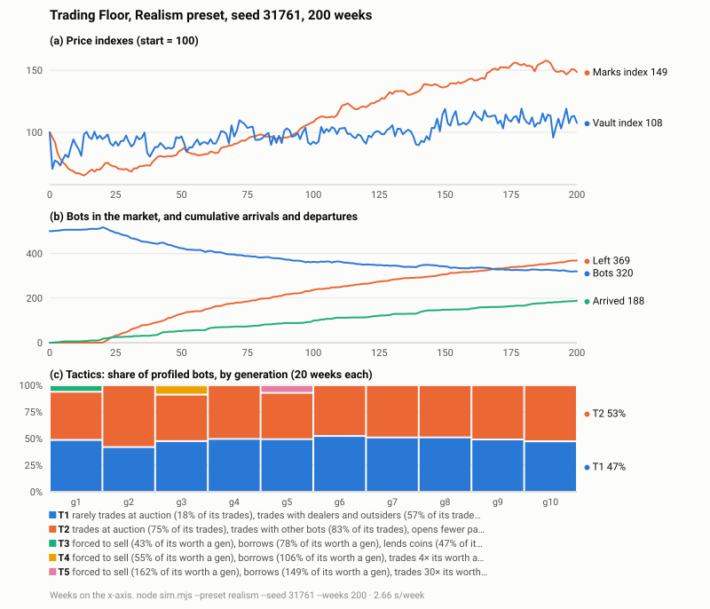

# Trading Floor

Trading Floor simulates a trading-card market. About 500 neural-network bots buy, sell, auction, lend and short
cards of players in a simulated football league. Card values follow the players' simulated careers. Bots learn during
their lives and evolve across generations. The research question is what trading tactics emerge, spread, crowd each
other out or die, when the world sets only the economic forces and never what a bot does.



*Figure 1: Realism preset, seed 31761, 200 weeks. The command and run details are in
[docs/figures/README.md](docs/figures/README.md).*

## Quickstart

Requires Node 20 or later. There are no build steps and no dependencies for the simulation.

```bash
node sim.mjs --preset realism --seed 31761 --weeks 100   # about 4 minutes, writes runs/realism-31761/run.json
node tactics_report.mjs runs/realism-31761/run.json      # tactic timeline by generation
node build_page.mjs                                       # rebuilds docs/trading-floor.html
```

Open `docs/trading-floor.html` in a browser to run the world live, change any setting while it runs, or load a saved
`run.json` and replay it. A run is deterministic: the same code, settings and seed give the same frames.

Creating the Realism world takes about 2 minutes, most of it the bots' practice generations. After that a week takes
about 1.9 seconds with 500 bots on one core of an Apple M1 Pro.

## What is simulated

- **The league.** 32 clubs with 10-player rosters, about 320 active players. 203 players and their real career
  histories come from one Retro Bowl save. The rest are generated from rates measured in that save. Seasons are
  simulated week by week: form, injuries, awards, retirement, rookies. A player's card value follows his production.
  The save has no ages, so each player's age is a random draw from real NFL rookie ages. A rookie plays a real
  early-career season's rates and inherits that player's skill and grade (both assumptions, listed in the model).
- **The cards.** 16 card markets per player (4 designs × 4 finishes), plus one-of-a-kind items. Cards enter through
  packs, sold in a weekly auction.
- **The markets.** A weekly order book, sealed-bid auctions, card lending and short selling, cash loans between bots,
  outside dealers, and a liquidator for forced and defaulted holdings.
- **The bots.** Each bot has two small neural networks. One scores cards, deciding what to buy, sell, bid, research
  and open. The other sets its stance: cash share, borrowing, lending, when to quit.
- **Learning and evolution.** Bots trial small changes to their networks and keep those that score better. At each
  generation end (20 weeks) the worst are replaced by mutated copies of the best. Bots also join, leave and die,
  passing their holdings to heirs.
- **What bots can know.** No bot reads a player's hidden value directly. It reaches them only through disclosed
  channels: the public price guide (a week old), dealers who trade around last week's value, and royalties, which
  are paid from that value and so reveal it closely. Prices, cost bases and AI bots' views are built from public data.
- **The Realism preset.** Royalties paid from each week's games, living and holding costs, a wealth tax, a public
  price guide, cash shocks, card loss, and fitness measured at what a bot could actually sell for. Every number not
  measured from the save is listed as an assumption.

The full model description, in the ODD protocol format, is in [docs/MODEL.md](docs/MODEL.md).

## Measurements

The engine records diagnostics every week and every generation. Diagnostics only observe; none of them feed back
into the world.

- Price indexes (a repeat-sales Vault index and a marks index), the health board, inequality (Gini), and the money
  ledger.
- Skill carry-over between generations, descent from the previous winners, network and behaviour distances, and
  strategy clusters.
- The tactic tracker. It profiles what each bot did in a generation, clusters the profiles, follows clusters across
  generations, and flags crowding and cannibalization.
- How often each limit on the bots binds, the entry multiplier, and the bots' own order book.

Definitions are in [docs/METRICS.md](docs/METRICS.md) and [docs/TACTICS.md](docs/TACTICS.md).

## Results so far

These are observations from specific runs. Each comes with the settings and the engine version that produced it. Most
were made before the full league was added (engine 0.x, about 28 active players), so they describe that world. All but
the last row came from engine 0.x or 1.0, before the audit's fixes (engine 2.0.0), and have not been re-run.

| Observation | Runs |
|---|---|
| Skill does not carry over between generations. The rank correlation of a bot's return from one generation to the next was between −0.03 and −0.08 under all 11 settings tested. About 5% of each generation descends from the previous top 10%. | 11 settings × 3 seeds × 300 weeks, engine 0.3 |
| Changes kept by learning within a lifetime do no better afterwards (follow-up correlation about −0.02), under every trial yardstick tested. Only 30-week trials hint at a signal (+0.09, with seed spread covering zero). | same, engine 0.3 |
| The quit rule shapes the economy more than any other setting tested. With quitting after heavy losses, prices track the football at 0.69 against 0.39, and the Gini is 0.47 against 0.56. | same, engine 0.3 |
| The population drains, with about four exits for every entry. | same, engine 0.3 |
| Bots rarely trade with each other. 68% of cards have no bot orders in a given week, and asks outnumber bids about 4 to 1. | seed 11906, 300 weeks, engine 1.0 or earlier |
| In the full league, two tactics coexist at roughly 50/50: auction traders, and bots that trade with dealers and open packs. Generation 5 flagged the auction traders as cannibalized. The clusters are weak (silhouette 0.15–0.25). | Realism, seed 31761, 120 weeks, engine 1.0 |
| Over 200 weeks of the full league, the population fell from 501 to 320 bots (188 arrivals, 369 departures). The marks index rose to 149 while the repeat-sales Vault index ended at 108. The same two tactics held through all 10 generations. Three short-lived heavy-borrowing tactics each lasted one generation. | Figure 1: Realism, seed 31761, 200 weeks, engine 1.0 |

The detailed record, including the comparisons behind each line, is in [docs/DEVLOG.md](docs/DEVLOG.md).

## Audit

A full audit of the engine and the planned experiment design was completed on 2026-11-07. It inventoried 271 forces
in the code and checked 202 flagged findings. 141 were confirmed (51 important, 90 minor); none blocks the current
runs. Confirmed findings include hidden information reaching bots, some decisions scripted by code rather than the
bots' networks, mechanism bugs, and 61 constants not yet labelled as assumptions. Every finding, its fix and its
status is in [docs/AUDIT.md](docs/AUDIT.md).

The fixes landed in engine 2.0.0 (2026-11-07). Of the 141 confirmed findings, 116 are fixed and 25 are deferred to the
government build, because they matter only once a government reads the state or owns the treasury. None is open. The
fixes change results: runs on engine 1.x are not comparable with 2.0.0 ([CHANGELOG.md](CHANGELOG.md) says why).

## Planned: an AI government

A Claude session acting as the world's government is specified but not built or run. It would set the taxes, fees
and spending, own the treasury that taxes fill, and post on a board the bots read. It would run on a real-time clock,
with no guardrails and no known end date. The question is whether it grows the economy that pays it, takes what it
can, or does something else. The specification, control arms, hypotheses and conduct rules are in
[docs/regulator-spec.md](docs/regulator-spec.md).

## Data

League statistics were transcribed from screenshots of one personal Retro Bowl save, through the upload and audit
pipeline of a companion fan site. No screenshots are included. Provenance, and which files are real, measured or
generated, are in [docs/DATA.md](docs/DATA.md). Retro Bowl is made by New Star Games. Team names follow the NFL. This
project is not affiliated with or endorsed by either.

## Limitations

- One league, built from one save. Results may not transfer to other markets or other leagues.
- Bots are small networks with fixed inputs. They see what the inputs give them, and nothing else.
- Most results so far rest on 3 seeds or fewer. Generations are noisy, and the tactic clusters are weak.
- Some numbers in the model are assumptions, not measurements. They are listed in [docs/MODEL.md](docs/MODEL.md) and
  [docs/AUDIT.md](docs/AUDIT.md).
- Most results above came from engine 0.x and 1.0, before the audit's fixes. Each is labelled with the engine version
  that produced them and has not been re-run on 2.0.0, except Figure 1.

## Repository layout

| Path | Contents |
|---|---|
| `engine.mjs` | The whole world: league, markets, bots, learning, diagnostics. Used by both the page and the command line. |
| `sim.mjs` | Headless runs of the neural-bot world |
| `tactics_report.mjs` | Prints a run's tactic timeline |
| `run.mjs`, `prompts/`, `configs/pilot.json` | An earlier runner where LLM bots take some seats. It needs an API key or a Claude login. |
| `page/`, `build_page.mjs` | The browser page, built into `docs/trading-floor.html` |
| `configs/` | Presets and run configs (`realism.json`) |
| `data/` | League and card data (see [docs/DATA.md](docs/DATA.md)) |
| `docs/` | Model, metrics, tactics, data, decisions, audit, the government spec, and the development log |
| `*.ts`, `build_library.py`, `measure_*.mjs` | Scripts that rebuild `data/` from a companion fan-site checkout |

## Citation

See [CITATION.cff](CITATION.cff). Use the engine version from [CHANGELOG.md](CHANGELOG.md) when citing a result.

## License

No license has been chosen yet. Until one is, all rights are reserved.
